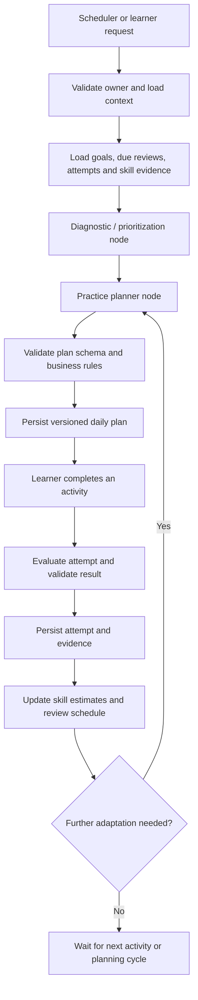

# SpeakUp AI — Adaptive Multi-Agent Learning System Plan

**Repository:** `uttarooque73/learn-english`  
**Status:** Approved and in active implementation. Completed phases are recorded in the implementation status section at the end of this document.  
**Implementation approach:** Incremental, test-first, backward-compatible, and feature-flagged.  
**Primary objective:** Turn SpeakUp AI into an adaptive English-learning application that uses a LangGraph.js workflow to plan practice, evaluate evidence from completed exercises, and adjust future learning.

## 1. Product vision and outcomes

The application should build a personalized daily learning routine around the learner's goals, available time, strengths, recurring mistakes, and recent practice. It should connect the existing learning experiences instead of replacing them with disconnected AI features.

### Desired outcomes

- Produce a useful daily plan with a configurable number of minutes and activities.
- Improve speaking fluency, pronunciation, grammar, vocabulary, listening comprehension, and confidence.
- Remember practice history and skill progress across sessions, browsers, and application restarts.
- Select the next activity based on due reviews, recent mistakes, skill estimates, learner preferences, and available time.
- Evaluate completed work, explain feedback, and use supported evidence to adapt later plans.
- Run scheduled planning and maintenance jobs reliably, with retries and protection against duplicate work.
- Keep existing manual practice usable when scheduled workers or the local model are unavailable.
- Make recommendations understandable: show why an activity was selected and what evidence influenced an adjustment.

### Product principles

1. **Evidence before adaptation:** Do not claim mastery or improvement without a saved practice attempt or other explicit evidence.
2. **Learner remains in control:** The system recommends and schedules practice; it does not pretend the learner completed an exercise.
3. **One durable source of truth:** Persist application state in the database. Browser state may cache UI data but must not be the canonical record.
4. **Bounded agent behavior:** Agents have explicit input/output contracts, timeouts, limits, and failure paths.
5. **Incremental migration:** Preserve current learner data and existing routes while moving toward normalized, testable persistence.
6. **Privacy and isolation:** Every read and write must be scoped to the correct learner/owner.
7. **Explainable changes:** Store plan versions, assessment evidence, agent outcomes, and reasons for important changes.

## 2. Current application baseline

The repository currently contains a Next.js 16, React 19, TypeScript application that uses SQLite and a local Ollama model. Existing learning functionality includes:

- AI conversation practice and conversation coaching.
- Vocabulary learning and spaced repetition.
- Grammar and mistake feedback, including micro-lessons.
- Shadowing and pronunciation practice.
- Listening/practice experiences.
- Daily learning plan and learning preferences.
- Learning analytics and progress views.
- Existing API routes, database helpers, SQL migration files, Vitest tests, and Playwright tests.

### Phase 0 audit findings (initial code inspection)

- Most feature state still uses serialized records in the generic `app_user_data` table rather than purpose-built relational tables. `client-persistence.ts` hydrates a synchronous in-memory cache from `/api/persistence`, imports legacy `speakup:*` localStorage entries when a server key does not already exist, then removes those legacy browser keys. New writes are sent asynchronously to the database; failed writes reset the initialized flag but are not surfaced to the learner, so durability/error visibility needs improvement before relying on these writes as assessment evidence. The persistence API scopes reads, upserts, and deletes by the HTTP-only owner cookie and limits values to 2 MB.
- `src/lib/database.ts` exports `ensurePersistenceSchema()`, which currently creates only `app_user_data` and its owner index. It uses a module-level `schemaReady` boolean and does not itself apply the numbered SQL files.
- Numbered SQL migration files exist under `db/migrations`, but at least the daily-vocabulary and conversation-coach API routes also define/create their tables inline. This means schema ownership is split between migration files and route-level schema setup. Phase 1 must consolidate schema changes behind one ordered, versioned migration path without breaking existing installations.
- The conversation-coach and daily-vocabulary tables already include owner-scoped queries and indexes in the inspected code. Phase 1 must preserve and test those boundaries, and audit all other routes rather than assume every feature is equally protected.
- The application uses an HTTP-only `speakup_owner` cookie for owner scope. Background jobs cannot rely on a browser cookie; each scheduled job must carry a validated owner identifier and enforce the same isolation rules.
- A durable scheduled-job/worker and LangGraph checkpointing design has not yet been established.
- The existing conversation-coach test already asserts that tutor playback failure remains visible while hands-free microphone recovery continues. The implementation was clearing the error when restarting recognition. PR [#41](https://github.com/uttarooque73/learn-english/pull/41) changes the automatic recovery path to preserve the message while manual microphone starts still clear stale errors. Both CI jobs for PR #41 passed. The fix remains unmerged pending the overall implementation sequence.

**Baseline reference:** [Inspected main commit](https://github.com/uttarooque73/learn-english/commit/f2fa05188be56afb5456e3a4b91bf3bd15cec16a)  
**CI run inspected:** [Previous GitHub Actions run](https://github.com/uttarooque73/learn-english/actions/runs/38993144048)

The Phase 0 CI run for PR [#41](https://github.com/uttarooque73/learn-english/pull/41) passed both the quality job (lint, type-check, unit/integration coverage tests, and production build) and Playwright UI tests. PR [#42](https://github.com/uttarooque73/learn-english/pull/42) centralizes the numbered migrations, records migration checksums, removes duplicate inline table creation from the Daily Vocabulary and Conversation Coach session routes, and adds the first additive learning-domain schema. The latest CI run for this expanded migration change is pending.

This is a repository inspection snapshot. Continue auditing all feature persistence paths before adding new learning-system tables.

## 3. Scope and feature inventory

### 3.1 Learner experience

| Feature | Expected behavior | Persistence required |
| --- | --- | --- |
| Adaptive daily plan | Generate a prioritized set of activities for a learner's target duration and current needs. | Plan, date, version, status, items, selection reasons |
| Configurable learning preferences | Store daily time target, preferred activity mix, goals, level, and schedule/time zone. | Learner profile and preferences |
| Conversation practice | Choose suitable prompts, provide coaching, and capture completed attempts. | Session, turns/summary as applicable, evaluation evidence |
| Vocabulary | Configure topic and quantity; review due words and rate recall. | Vocabulary items, review history, next due time, learner settings |
| Grammar and mistake coaching | Identify recurring error categories and offer targeted explanations and exercises. | Mistakes, examples/evidence, feedback, completion outcomes |
| Shadowing and pronunciation | Practice a word or sentence, compare/assess attempts where supported, and retain history. | Prompt, attempt, available audio/model metadata, assessment |
| Listening practice | Select or generate level-appropriate listening tasks and assess answers. | Activity, responses, score, skill evidence |
| Micro-lessons | Recommend short lessons based on a specific recurring need. | Lesson assignment, completion, outcome |
| Spaced repetition | Schedule review based on recall result and configured repetition policy. | Review events and next due timestamp |
| Progress and analytics | Show activity, consistency, skill trends, common mistakes, and due work. | Append-only attempt/evidence history and derived aggregates |
| Plan controls | Let the learner pause scheduled planning, change preferences, or regenerate a plan. | Preferences, job status, plan version history |
| Explainability | Explain why each activity was selected and which saved signals influenced it. | Reason codes and safe evidence references |

### 3.2 Platform and operations

- Durable scheduled job processing with idempotency, retry/backoff, leases, and recovery of abandoned jobs.
- Persisted LangGraph checkpoints so interrupted workflows can resume safely.
- Agent run history with status, duration, model/provider, prompt version, and validated result metadata.
- Owner-level authorization and data isolation across all API routes and background tasks.
- Input/output validation for model responses; model output is untrusted input.
- Model/provider abstraction so Ollama can be used locally and a compatible provider can be introduced without rewriting learning logic.
- Operational logs and metrics for job failures, model latency, invalid outputs, retries, and plan-generation outcomes.
- Feature flags and staged rollout so the new workflow can be disabled without removing existing learning features.

## 4. Proposed architecture

Use **LangGraph.js** as the workflow orchestrator, with typed state and explicit graph nodes/edges. Keep business rules and database access in application services; do not put SQL, authentication, or unrestricted side effects inside prompts.

### 4.1 Logical components

1. **Web/API layer (Next.js):** Authenticates/identifies the owner, validates requests, serves current learning experiences, and starts user-requested workflows.
2. **Learning domain services:** Own profile, plans, vocabulary, practice attempts, assessment evidence, spaced-repetition scheduling, and progress calculations.
3. **LangGraph workflow:** Coordinates the appropriate diagnostic, planning, practice-selection, evaluation, and adaptation nodes.
4. **Model provider adapter:** Wraps the local Ollama integration behind a typed interface, with model settings and timeouts configured outside prompts.
5. **Persistence layer:** Provides transactional, owner-scoped database operations and versioned migrations.
6. **Durable worker/scheduler:** Claims due jobs, runs bounded workflows, persists outcomes, retries recoverable failures, and recovers expired leases.
7. **Observability:** Records structured run/job outcomes without logging secrets or unnecessary learner content.

### 4.2 Daily planning and practice lifecycle

The scheduled workflow can prepare a plan and reminders. It cannot fabricate completion, speaking evidence, listening responses, or progress. Evaluation of an activity happens only after a real attempt is submitted.

### 4.3 Graph and agent contracts

- Define a shared typed state containing owner ID, run ID, goal/time budget, profile snapshot, due work, recent evidence references, candidate activities, plan draft, validation results, and error/retry metadata.
- Keep large histories in the database and pass bounded summaries/references into graph state.
- Use structured output schemas and validate them before persistence.
- Give every node a documented input, output, side-effect policy, timeout, retry policy, and fallback.
- Use deterministic domain code for scoring rules, access control, scheduling, and schema validation. Use the model for bounded tasks such as feedback generation, classification, and candidate selection.
- Parallelize independent read-only analysis only when measurements justify it; serialize conflicting database updates and plan writes.
- Persist graph checkpoints with a stable thread/run identifier and define checkpoint cleanup/retention.
- Version prompts and graph definitions so runs can be diagnosed after a deployment.

## 5. Agent responsibilities

Start with a small number of explicit roles. An “agent” should exist only where it adds a clear capability; simple deterministic work should remain ordinary code.

| Agent / node | Responsibility | Input | Output / guardrails |
| --- | --- | --- | --- |
| Learner Context Loader | Gather profile, goals, recent attempts, mistakes, due reviews, and current plan. | Validated owner ID and date | Bounded, owner-scoped context; no model call required |
| Diagnostic Agent | Summarize likely skill gaps and confidence from saved evidence. | Recent evidence references and skill history | Structured skill priorities with confidence and supporting evidence IDs; never invent observations |
| Practice Planner Agent | Select and sequence activities within the learner's time budget. | Goals, due reviews, priorities, available activities | Typed plan items with duration, skill, priority, and reason codes |
| Activity / Tutor Agent | Generate or adapt prompts and explanations for existing practice modes. | Activity type, level, learning objective | Appropriate prompt/content within safety and level constraints |
| Evaluation Agent | Evaluate a submitted answer or completed attempt. | Learner response and activity rubric | Structured feedback, score where measurable, error categories, confidence, and evidence |
| Mastery / Review node | Update deterministic skill aggregates and spaced-repetition dates. | Validated evaluation and previous state | Database changes calculated by domain rules; no unsupported mastery claims |
| Progress Analyst | Summarize trends and explain plan changes. | Saved history and derived metrics | Concise explanation with date ranges and data basis |
| Orchestrator | Route between nodes, handle conditional branches, and stop safely. | Typed graph state | Bounded route, retry/timeout behavior, and terminal status |

**First release:** implement the context loader, a minimal diagnostic node, planner, and evaluator. Add separate specialist agents only when an existing feature needs them and test results justify the extra complexity. Do not require all agents to run for every request.

## 6. Data model and migration strategy

The following is a **proposed target model**, not a ready-to-run migration. Final table definitions must follow the Phase 0 audit of the current schema, owner identifier type, migration mechanism, and serialized data formats.

### 6.1 Proposed entities

| Entity | Key fields / purpose |
| --- | --- |
| `schema_migrations` | Migration version, checksum, applied timestamp; enables ordered, auditable migration execution. |
| `learner_profiles` | Owner ID, time zone, daily target minutes, level/goals, preferences, schedule enabled flag. |
| `learner_skill_scores` | Owner ID, skill key, mastery estimate, confidence, evidence count, updated timestamp. |
| `skill_assessments` | Owner ID, skill, score/assessment result, rubric/version, evidence references, timestamp. |
| `learning_plans` | Owner ID, learner-local date, status, version, generation source, created/updated timestamps. |
| `learning_plan_items` | Plan ID, activity type/reference, skill, duration estimate, priority, reason codes, status/order. |
| `practice_attempts` | Owner ID, plan item/reference, activity type, response/result, duration, submitted/completed timestamps. |
| `learning_mistakes` | Owner ID, normalized category, counts, last-seen time, resolved/active status, evidence references. |
| `vocabulary_review_events` | Owner ID, vocabulary item/reference, recall rating, interval, next due timestamp, policy version. |
| `agent_runs` | Owner ID, workflow/run ID, agent/node, status, prompt/graph version, model metadata, input hash, timing, safe error metadata. |
| `scheduled_jobs` | Owner ID, job type, scheduled time, status, attempts, idempotency key, lease expiry, last error, timestamps. |
| `graph_checkpoints` or LangGraph checkpoint tables | Stable thread/run ID, checkpoint state, metadata, timestamps and retention fields as supported by the selected saver. |

Use existing vocabulary, conversation, user-data, and learning tables where they already correctly model the domain. Do not create duplicate sources of truth just to match this list.

### 6.2 Database invariants

- Every learner-owned record must have a consistent owner key and owner-scoped access path.
- Use foreign keys and indexes where supported and appropriate; validate SQLite foreign-key behavior in the actual connection setup.
- Enforce one active/current plan per owner and learner-local date, while retaining prior plan versions or a clear plan history.
- Use transactions for migration, plan publication, attempt/evaluation persistence, and mastery/review updates that must remain consistent.
- Store timestamps consistently (UTC for instants) and retain the learner time zone for local-day calculations.
- Keep append-only evidence/history where it improves auditability; derive aggregate skill scores from validated evidence.
- Store structured JSON only where schema flexibility is justified, validate it, and avoid hiding core queryable relationships in serialized blobs.
- Make retries idempotent so the same attempt/job cannot apply the same mastery update twice.
- Never log cookie values, secrets, raw credentials, or full learner content unnecessarily.

### 6.3 Migration requirements

1. Inventory all tables, migrations, migration execution paths, data formats, reads/writes, and cleanup behavior.
2. Create a versioned, transactional migration runner or safely extend the existing mechanism; do not introduce a competing migration path.
3. Back up or otherwise provide a recoverable path before data transformation.
4. Add new schema additively first; preserve existing readers and writers during transition.
5. Backfill existing serialized records in batches with validation, counts, and resumable progress.
6. Compare source and destination counts and representative records; report malformed or unconvertible records without silently discarding them.
7. Switch reads/writes behind a feature flag or controlled compatibility layer only after validation.
8. Remove legacy storage only in a later approved phase, after usage and rollback criteria are met.
9. Test fresh database setup, upgrade from realistic existing databases, repeated migration execution, interrupted migration recovery, and preservation of existing learner data.

## 7. Scheduled workflows and reliability

### 7.1 Job lifecycle

- Store each scheduled job durably before acknowledging it.
- Claim jobs transactionally using a lease or equivalent concurrency-safe mechanism.
- Use an idempotency key such as owner + job type + learner-local date + plan generation version.
- Apply bounded exponential backoff for transient model/database failures; mark non-recoverable jobs as failed with safe diagnostic details.
- Recover jobs whose leases expired after worker crashes.
- Limit concurrent jobs and model calls; avoid starving interactive practice.
- Enforce per-owner quotas and prevent duplicate daily plans under concurrent requests.
- Make retrying a job safe even if the prior worker completed some database writes before crashing.

### 7.2 Scheduling rules

- Schedule by each learner's configured time zone, not the server's local clock.
- Provide a configurable daily schedule and target duration.
- Skip or pause generation when the learner disables it, has no valid profile, or is not eligible under configured policy.
- Reconcile missed schedules after downtime with a defined catch-up policy rather than creating an unbounded backlog.
- Distinguish a planned activity from a completed activity.
- Keep a manual “generate/regenerate plan” path with rate limits and clear behavior for existing plans.

### 7.3 Deployment model

- **Local development:** Run a separate TypeScript worker process alongside Next.js; do not rely on an in-process timer tied to a web request.
- **Self-hosted deployment:** Run the worker under a process supervisor with health checks and graceful shutdown.
- **Serverless deployment:** Do not assume local Ollama or local SQLite files are available to independent instances. Confirm access to a persistent database and reachable model endpoint before choosing this topology.
- Keep the scheduler trigger thin: it should enqueue durable jobs rather than execute long model workflows inside the trigger request.

## 8. API and UI changes

Reuse existing pages and service boundaries where possible. Avoid a broad UI rewrite.

### Learner-facing UI

- **Today's Learning Plan:** ordered activities, duration estimate, skill focus, reason for recommendation, progress/status, and start/resume actions.
- **Plan preferences:** daily target minutes, schedule/time zone, activity preferences, goal/level, and pause/resume controls.
- **Activity history:** completed attempts, feedback, saved mistakes, vocabulary review history, and pronunciation/shadowing history.
- **Progress dashboard:** practice consistency, activity mix, skill trends, due reviews, and recurring error categories.
- **Plan explanation:** concise human-readable reasons based on stored signals, not unsupported claims about the learner.
- **Failure states:** helpful retry or manual-practice options if the model or scheduler is unavailable.

### API/service requirements

- Validate all inputs and model-generated outputs with runtime schemas.
- Scope every operation by the authenticated/validated owner context.
- Make plan generation, evaluation, and job status endpoints explicit about status and idempotency.
- Use appropriate status codes for invalid input, unavailable model, rate limits, and internal failures.
- Avoid exposing prompts, internal stack traces, raw checkpoint data, or secrets to the browser.
- Preserve existing API contracts or introduce versioned/compatible changes with tests.

## 9. Incremental implementation roadmap

Each phase should be a separate, reviewable pull request where practical. Later phases must not begin until the previous phase's exit criteria are satisfied.

### Phase 0 — Stabilize and audit

**Work**
- Recheck current `main`, latest CI, and working baseline.
- Diagnose and fix the existing conversation-coach test/behavior mismatch without weakening assertions.
- Inventory migration execution, schema, generic serialized storage, owner scoping, API reads/writes, and feature persistence.
- Document current data counts and compatibility constraints.
- Run lint, type-check, unit/integration tests, production build, and Playwright suite.

**Exit criteria**
- Baseline CI is green or any unrelated, verified failures are clearly isolated and documented.
- A migration/data-flow map identifies canonical storage for each feature.
- Owner-scoping rules and scheduled-worker identity model are documented.

### Phase 1 — Database foundation and safe migrations

**Work**
- Implement or improve ordered migration tracking and transactional migration execution.
- Add only the target tables and indexes justified by the audit.
- Add migration/backfill validation and compatibility tests.
- Keep existing application behavior unchanged.

**Exit criteria**
- Fresh install and upgrade paths pass.
- Re-running migrations is safe.
- Existing learner data is preserved and counts/reconciliation are verified.
- Owner isolation is tested at the database/service boundary.

### Phase 2 — Workflow foundation

**Work**
- Add LangGraph.js and the compatible model-provider adapter.
- Define typed graph state, schemas, node contracts, timeout handling, and error boundaries.
- Persist workflow run metadata and checkpoints using a supported persistence adapter.
- Add deterministic test doubles so tests do not require a live Ollama service.

**Exit criteria**
- A minimal graph can run, resume where supported, validate output, and persist status.
- Invalid model output, timeout, and provider outage produce bounded, testable failures.
- Interactive endpoints remain responsive.

### Phase 3 — Initial diagnostic, planner, and evaluator

**Work**
- Build context loading and evidence summarization.
- Generate a time-bounded plan from learner goals, due reviews, and saved evidence.
- Validate plan duration, activity types, limits, and required fields before saving.
- Evaluate submitted attempts against activity-specific rubrics and persist evidence.
- Version prompts and keep scores/confidence separate.

**Exit criteria**
- A learner can go from saved profile/evidence to a valid daily plan.
- A completed exercise produces a persisted attempt and validated feedback.
- Missing or low-confidence evidence does not trigger strong mastery claims.

### Phase 4 — Integrate existing learning features

**Work**
- Connect conversation practice, vocabulary, grammar/mistake coaching, shadowing/pronunciation, listening, and micro-lessons to common attempt/evidence services.
- Reuse existing user-facing experiences; do not remove working routes.
- Migrate historical data only where the audit establishes a safe mapping.
- Ensure all relevant histories are database-backed; browser storage is only a cache where needed.

**Exit criteria**
- Activity completion is consistently persisted and visible after reload/restart.
- Existing feature behavior and history remain compatible.
- Each integrated activity emits appropriately typed evidence.

### Phase 5 — Durable daily scheduler and worker

**Work**
- Implement job enqueueing, transactional claims, leases, retry/backoff, idempotency, and abandoned-job recovery.
- Add a protected worker entry point and health/status reporting.
- Generate one current plan per eligible owner and learner-local date under retries and concurrent triggers.
- Add pause/resume and manual regeneration behavior.

**Exit criteria**
- Jobs survive process restarts and are not silently lost.
- Retries/concurrent runs do not create duplicate plans or double-apply updates.
- Time-zone and catch-up behavior are covered by deterministic tests.

### Phase 6 — Evidence-based adaptation

**Work**
- Update skill estimates from validated attempts using explicit deterministic rules.
- Adjust activity mix and review timing from recurring mistakes, review outcomes, recent evidence, and confidence.
- Keep prior plan versions and store reason codes for plan changes.
- Add guardrails against drastic changes based on one noisy or low-confidence attempt.

**Exit criteria**
- The same evidence and configuration produce predictable domain-level updates.
- Adaptation reasons can be explained from saved data.
- A failed/partial evaluation does not corrupt mastery or review scheduling.

### Phase 7 — Learner controls and progress UX

**Work**
- Add/finish Today's Plan, preferences, progress, activity history, schedule status, and pause/resume controls.
- Show helpful loading, empty, error, and model-unavailable states.
- Explain recommended activities using stored reason codes and evidence references.
- Keep manual practice available when background automation is disabled.

**Exit criteria**
- Learners can understand, follow, pause, and recover their learning routine.
- Data remains correct after refresh, sign-in/owner context changes, and restart.
- Key flows pass end-to-end tests.

### Phase 8 — Hardening and staged rollout

**Work**
- Add structured operational metrics and safe logs.
- Load-test job concurrency, SQLite contention, model latency, and retry limits.
- Verify access control, input validation, prompt-injection boundaries, output validation, and data retention.
- Release behind a feature flag, monitor errors and completion rates, and document rollback steps.
- Remove obsolete persistence only in a separately reviewed cleanup change.

**Exit criteria**
- Required CI checks pass consistently.
- Rollback and data recovery steps are tested.
- Feature can be disabled without breaking existing practice features.

## 10. Test strategy and acceptance criteria

### Unit tests
- Planner duration/ordering/priority rules.
- Runtime schema validation for all agent outputs.
- Evaluation rubric and confidence handling.
- Spaced-repetition and mastery-update rules.
- Idempotency-key generation and time-zone/local-date calculations.
- Graph routing and stop conditions.

### Database and migration tests
- Fresh database and upgrade from a representative prior schema.
- Migration repeatability, interrupted migration recovery, and data reconciliation.
- Foreign keys, indexes, transactions, and owner isolation.
- Plan uniqueness by owner/local date and safe plan versioning.
- Attempts/evidence persist across reload and application restart.

### Integration tests
- Ollama/model provider success, timeout, unavailable model, malformed response, and retry.
- Scheduler claims, expired leases, duplicate triggers, concurrency, and exhausted retries.
- A worker crash after a partial write does not double-apply evaluation or mastery updates.
- All learner-owned API routes reject cross-owner access.

### End-to-end tests
1. Configure learning goals and daily target.
2. Generate or receive a daily plan.
3. Start and complete an activity.
4. View saved feedback and attempt history after reload.
5. Verify skill/review updates use the attempt evidence.
6. Verify a later plan reflects supported changes.
7. Pause scheduled generation and confirm manual practice still works.

### CI gates

- Lint.
- Type-check.
- Unit and integration tests.
- Coverage thresholds at a measured baseline, increased deliberately rather than arbitrarily.
- Production build.
- Playwright end-to-end tests.
- Migration tests on a clean database and a representative upgraded database.
- No tests should depend on an external live model unless explicitly marked as an opt-in smoke test.

## 11. Security, privacy, and operational requirements

- Treat model output and user-provided learning content as untrusted.
- Enforce owner scope in domain services and SQL operations; do not trust owner IDs supplied by the client without validation.
- Use a separate authenticated/internal mechanism for scheduler and worker invocations.
- Bound input length, output tokens, graph depth/steps, runtime, concurrent requests, and retries.
- Prevent arbitrary tool execution and unrestricted database access by model-generated content.
- Store the minimum learner content needed for learning history and evaluation; define retention/deletion behavior.
- Redact secrets and avoid logging full personal responses by default.
- Use safe error categories for user-facing messages and more detailed but redacted internal diagnostics.
- Add monitoring for queue depth/age, job failures, graph duration, model timeouts, invalid outputs, and plan generation success.
- Document backup/recovery expectations for SQLite and checkpoint data.

## 12. Key decisions and open questions

### Recommended defaults

- **Orchestration:** LangGraph.js with typed state and bounded graph execution.
- **Model:** Keep Ollama as the initial provider behind an adapter; do not bind domain services to a single model implementation.
- **Database:** Retain SQLite initially if the deployment is single-instance and its concurrency profile is suitable; reassess if multi-instance workers or higher write concurrency are required.
- **Scheduling:** Separate durable worker process, with jobs persisted in the database.
- **Learning policy:** Deterministic rules for scheduling and state updates; model assistance for bounded diagnosis, content generation, and evaluation.
- **Rollout:** One phase/PR at a time, feature flags, backward-compatible migrations, and explicit acceptance checks.

### Resolve during Phase 0 before schema finalization

- Exact owner key type and lifecycle.
- Which existing tables and migration scripts are authoritative, and how they are applied in all environments.
- Existing serialized data shapes and migration volume.
- Which existing features already persist histories in dedicated tables.
- Exact Ollama client/library and LangGraph checkpoint-saver compatibility with current dependency versions.
- Deployment topology, worker availability, backup strategy, and expected concurrent users.
- Learner-local schedule defaults and catch-up policy.
- Data retention and deletion requirements for practice history and checkpoints.

## 13. Explicit non-goals for the first release

- Rewriting the application from scratch.
- Replacing every existing feature with an agent.
- Running every agent on every user request.
- Claiming precise pronunciation/accent scoring unless the available audio pipeline supports it and the score is validated.
- Fabricating practice completions or inferring mastery from plans that were never completed.
- Removing legacy data before backfill and compatibility are verified.
- Introducing distributed infrastructure or a second database without a measured requirement.
- Automatically merging implementation pull requests without review and required CI.

## 14. Definition of done for the overall initiative

The initiative is complete when:

- Existing features continue to work and their histories are persisted reliably.
- Learners can configure goals/time preferences and receive a valid daily plan.
- Completed activities create durable, owner-scoped attempts and evidence.
- Evaluation and adaptive planning are explainable and confidence-aware.
- Scheduled jobs survive restart and handle retries/concurrency without duplicate effects.
- LangGraph runs and failures are observable and bounded.
- Database migrations preserve existing data and are tested for fresh installs and upgrades.
- Security, accessibility, error handling, and end-to-end acceptance checks pass.
- The feature can be rolled back or disabled safely.
- Documentation explains setup, worker execution, configuration, troubleshooting, and recovery.

## 15. Approval and implementation rule

This file is the single planning source of truth for the initiative. Review and approve the scope, phases, and data strategy before application-code changes begin. After approval, implement Phase 0 first and update this file only when an explicit decision changes the agreed plan.

## 14. Implementation status — 2026-10-17

This plan is the active source of truth for implementation. Work is delivered in small pull requests; each phase must pass the repository's required CI checks before merge.

| Phase | Scope | Status |
| --- | --- | --- |
| 0 | Baseline audit and stability fixes | Merged (including PR #41) |
| 1 | Ordered, versioned database migrations and learning-domain schema | Merged (PR #42) |
| 2 | LangGraph.js, checkpointing, and model-provider foundation | Merged (PR #43) |
| 3 | Adaptive planner and evaluator | Merged (PR #44) |
| 4 | Connect existing activities to persisted learning evidence | Merged (PR #45) |
| 5–6 | Durable scheduler, worker, and evidence-based adaptation | Merged (PR #46) |
| 7 | Learner routine controls and adaptive progress UI/API | Merged (PR #47) |
| 8 | Security hardening, reliability/operational monitoring, end-to-end validation, and staged rollout | Core code and recovery regression tests merged (PRs #48–#49; post-merge CI passed); deployment load/migration checks remain |
| 10 | Graph-level integration tests, failure-path validation, and operator readiness | Graph execution/checkpoint/idempotency tests merged (PR #51; PR and post-merge CI passed); deployment-specific load and migration acceptance remains under Phase 8 |

| 9 | Full LangGraph multi-agent orchestration, conditional routing, and agent-level tests | Merged (PR #50; planning/evaluation graphs, conditional routing, run audit metadata, and post-merge CI passed) |

### Phase 8 implementation progress

- Merged the authenticated operations endpoint, privacy-safe aggregate metrics, and automation pause flag in PR #48; PR CI and post-merge `main` CI/Playwright passed.
- Added regression tests for repeated competing worker claims and SQLite backup/restore integrity, including restored learner data, migration ledger, and `integrity_check`. PR #49 is merged and its post-merge CI passed.
- Clarified operator instructions and distinguished automated regression coverage from required multi-process/load testing.
- Recovery-validation PR #49 is merged and its post-merge CI passed. An early PR validation attempt failed at type-check, but the corrected follow-up commit passed both CI jobs and the post-merge `main` run passed. Remaining before phase completion: run deployment-specific multi-process contention/load tests and representative migration/backup-restore checks against a deployment-like environment. These checks are not considered complete based on unit tests alone.

### Required execution rules

- Before each phase, inspect the current `main` branch and the latest CI results; do not rely on stale branch snapshots.
- Implement one phase at a time and keep database migrations additive and reversible where feasible.
- After each change, run the complete CI pipeline: lint, shell syntax checks, type-check, unit/integration tests with coverage, production build, and Playwright UI tests.
- Fix the cause of failures rather than weakening or deleting meaningful assertions. Re-run CI after the fix.
- Merge only after required checks pass, then verify the merge commit and `main` CI before starting the next phase.
- Keep local developer configuration and user data safe. Update scripts must never silently discard tracked edits or untracked files.
- Keep this status table current as phases merge; a phase is not complete merely because code was committed or a PR was opened.

## Floating AI English Partner feature (implementation branch)

Feature specification received on 2026-10-18. Implementation is in progress on branch `feat/floating-ai-conversation-feedback`; this is not yet considered complete.

- Added a root-layout floating conversation widget with topic and proficiency controls, browser speech recognition/synthesis, and a transcript/feedback panel.
- Added migration `008_floating_voice_conversations.sql` for owner-scoped session, transcript, and line-feedback persistence.
- Added incremental transcript persistence at `POST /api/voice-conversations/session`, session listing at `GET /api/voice-conversations/session`, and feedback finalization/history retrieval at `/api/voice-conversations/feedback`.
- Feedback analysis uses bounded batches, schema validation, and a partial/complete status so incomplete analysis is not reported as complete.
- Remaining before completion: implement and test interruption/continuous listening behavior across browser implementations; detect a spoken stop command; provide persisted session-history reopening in the UI; improve retry/resume behavior for failed transcript writes and feedback batches; enrich overall feedback and learning-plan integration; add automated unit/integration/Playwright coverage for the feature; run full CI and review security/accessibility/mobile behavior. Browser-native speech APIs are a compatibility fallback, not a provider-grade speech-to-speech implementation.
- Do not mark this feature complete until all Definition of Done requirements are verified and required CI passes.
